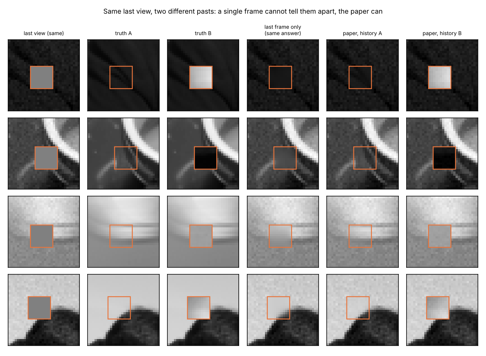
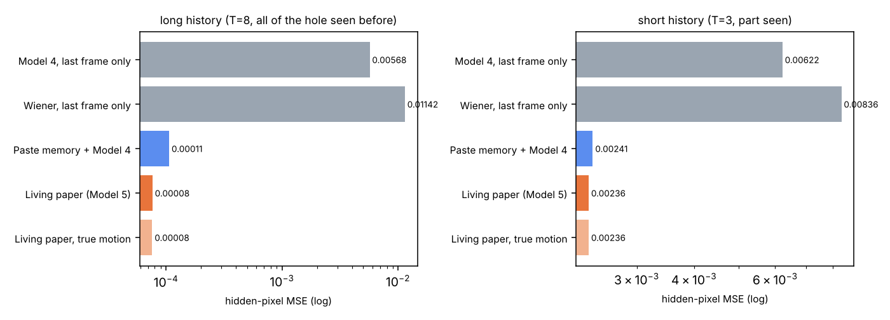
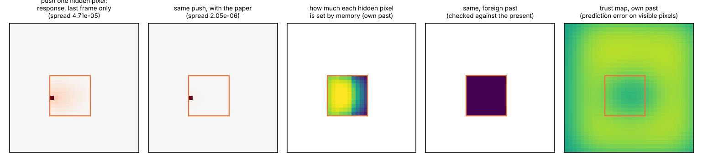
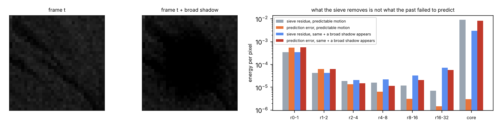

# SihtiImageModel5 — the living paper

**Model 4's image energy, plus a state that survives between frames.**
CPU only. No transformer, no pretrained network, no labels; hidden pixels are never seen by inference.

Model 3 and Model 4 explain one still image: local patch states and a coarse layout negotiate until the
hidden pixels settle. Model 5 keeps that engine unchanged (vendored from
[SihtiImageModel4](https://github.com/anttiluode/SihtiImageModel4), frozen with Model 4's own parameters)
and gives it a **paper**: a remembered image and a per-pixel precision that are carried between frames,
checked against what is visible now, and entered into the *same* energy as one more term.

The question, from Antti and Astra's "living paper" turn:

> Can two different histories produce different, appropriate interpretations of the same, currently
> ambiguous view — and does putting the history *inside* the image energy do better than pasting
> remembered pixels?

Gates were preregistered in [docs/PREREG.md](docs/PREREG.md) and pushed (cc7faf6), parameters tuned on
validation only and pushed (6405e00), **before** any test sequence was generated.



## What the model does (paper.py)

For frame t, with visible pixels y and occluder mask:

1. **motion**: integer global translation, estimated only from pixels visible in both frames;
2. **transport**: m⁻ = shift(m), π⁻ = ρ·shift(π);
3. **trust** (the prediction residue e = y − m⁻ on visible pixels): each error is scored by how *expected*
   it is under "this memory is of this scene", N(0, σ²(1+1/π)+σ²), versus "unrelated",
   N(0, 2·var(scene)+σ²). The log-likelihood ratios are pooled near each pixel and over the frame:
   trust = P(same | local) · P(same | frame). The hole can never be checked directly; it inherits its
   neighbours' verdict;
4. **inference**: Model 4's energy **plus** β/2 Σ_hidden trust·π⁻·(x − m⁻)², settled by Model 4's exact
   block-coordinate descent. History therefore changes *which local state* each patch takes, not only pixels;
5. **update**: visible pixels fuse (π⁻m⁻ + y)/(π⁻+1), π = π⁻+1. Hidden pixels take the settled value
   but keep π⁻: only observations add precision, so the model cannot learn from its own fill-ins.

## Test

Camera pans (integer velocity, |vx| 2–3, |vy| ≤ 1 px/frame) over three photographs never used for
training or tuning (`camera`, `coffee`, `clock`); 32×32 frames, sensor noise σ = 0.02, a **fixed** 10×10
occluder. **Long** = 8 frames, everything behind the occluder at the last frame was seen earlier.
**Short** = 3 frames, only about half of it was. **Twins**: the same pan with only the world region
behind the last occluder swapped for another photograph's patch — the last frame's observation is
bit-identical, the truths differ. **Foreign history**: another scene's real history, then this scene's
last frame. 48 long + 48 short sequences.

Hidden-pixel MSE of the last frame (lower is better):

| Method | Long (all of hole seen before) | Short (part seen) |
|---|---:|---:|
| Model 4, last frame only | 0.00568 | 0.00622 |
| Wiener, last frame only | 0.01142 | 0.00836 |
| Paste remembered pixels + Model 4 for the rest (strong baseline) | 0.000106 | 0.00241 |
| **Living paper (Model 5)** | **0.0000764** | **0.00236** |
| Living paper, true motion instead of estimated | 0.0000760 | 0.00236 |
| Living paper, trust check off | 0.0000773 | 0.00238 |
| Foreign history, trust check **on** | 0.00568 (= last frame only) | 0.00622 (= last frame only) |
| Foreign history, trust check off | 0.1532 | 0.0852 |
| Twin B, last frame only | 0.1477 | — |
| Twin B, living paper | 0.000119 | — |

Motion estimate wrong in 7 of 336 long and 3 of 96 short frame steps; it made no measurable difference.



## Preregistered gates

| Gate | Claim | Result | |
|---|---|---|---|
| **H1** | same last view, two histories, two right answers | paper/last-frame error ratio over both twins **0.0013** (≤ 0.5); own truth closer in **100%** (≥ 90%) | **PASS** |
| **H1b** | history changes *which local explanation* a patch takes, toward the right one | patch states matching the clean-image states: **79.2% → 88.6%**, +9.3 points (needed +10) | **FAIL** |
| **H2** | a history from elsewhere is checked against the present and switched off | foreign/last-frame **1.000** (≤ 1.10); with check vs without **0.050** (≤ 0.80) | **PASS** |
| **H2b** | the check costs nothing when the history is right | paper with/without check **0.993** (≤ 1.02) | **PASS** |
| **H3** | memory inside the energy beats pasting memory | long **0.718** (CI 0.65–0.78, wins 88% of sequences); short **0.980** (CI 0.88–1.03, wins 69%); needed ≤ 0.97 in both | **FAIL** |

## What this means — honestly

* **H1, H2b were instrument checks, said so in advance.** Memory of a region you saw beats guessing it,
  by ~75× here. That verifies the machine; it is not a discovery. The twin figure is still the cleanest
  picture of the idea: a single frame *cannot* tell the twins apart (identical answers in 48/48), the
  paper gives each its own past.
* **H2 is the useful part.** A wrong history is far worse than no history (14–27× worse with the
  check off). The likelihood-ratio check switched every foreign history off completely — the result equals
  the last-frame-only answer to the last digit — and cost nothing on the right histories. Its first,
  simpler form (exponential in local error) failed on *validation* and was replaced before
  preregistration; that is recorded in PREREG. Limit: a history that agrees with everything visible is
  believed. If the world changes only behind the occluder (the twin swapped mid-sequence), the paper
  will confidently paint the old content. Nothing visible can reveal that.
* **H1b missed by 0.7 points.** History does change local choices toward the right ones (65% of long
  sequences improve, 25% get worse), but not by the preregistered margin.
* **H3 failed as preregistered, and splits cleanly.** When the whole hole was seen before (long),
  memory inside the energy beats pasting by 28%, with a confidence interval well clear of the 3%
  threshold. The gain is denoising: pasted memory carries the sensor noise of the few views it averaged,
  and the patch prior cleans it. When only part was seen (short), the error is dominated by the
  never-seen part, which both methods fill with the same Model 4 machinery; the 2% gain is within noise.
  The hoped-for effect — remembered pixels pulling the *unseen* part right through overlapping
  patches — is not visible at this size.

## The ping with state: response operators



With the local states held fixed, the settled image solves A x_h = b, so a small push δf at one hidden
pixel moves the image by δx = A⁻¹δf. A column of A⁻¹ is the response to one "ping" (a Green's
function), and it depends on what the system currently holds. On the short sequence above:

* without the paper, a push spreads across the hole (total |response| 4.7·10⁻⁵);
* with the paper it stays put (2.0·10⁻⁶, about 23× smaller): where memory is confident, the medium is stiff;
* ∂x_h/∂m⁻ = A⁻¹βW is how much each hidden pixel is *set by memory*: about 0.71 on average with its own past
  (high where the hole was seen, falling toward the never-seen edge), 10⁻²⁷ with a foreign past.

This is the readable version of "the same signal travels differently depending on the state". It is
exact arithmetic about this model, not a finding about cortex.

## Two kinds of residue (illustration, not a test)



The Sihti residue r_k = x_k − x_{k+1} answers "what did this filter remove?". The prediction residue
e = x_t − x̂_t answers "what did the past fail to predict?". Pushed through the same sieve on a noisy
frame of predictable motion, the prediction error sits in the finest bands (sensor noise, which nothing
predicts), while in the coarse bands it is thousands of times smaller than what the sieve removes (core:
3·10⁻⁶ vs 9·10⁻³). Add a broad soft shadow and the prediction error appears in the *coarse* bands
(core 8·10⁻³). Unexplained is not the same as high-frequency.

## Run it

```bash
pip install -r requirements.txt pytest
python -m pytest -q                    # 9 tests: energy, exactness, no leak, twins, trust, operators
python tune.py                         # validation only -> params.json (about 40 min)
python run5.py                         # the preregistered test -> results/natural/ (about 5 min)
python run5.py --folders ~/THINGS/unseen --name folders --n 24
                                       # pans over your own photographs (not a gate run)
```

The first run fits Model 4's patch mixture (about 2 minutes) and caches it in `runs/`.

| File | What |
|---|---|
| `paper.py` | the living paper: motion, transport, trust, memory term, update, response operators |
| `sequences.py` | pans, occluder, noise, twins, foreign histories, your folders |
| `bench5.py` | every arm on the same sequences |
| `tune.py`, `params.json`, `docs/tune_log.txt` | validation tuning |
| `run5.py`, `results/natural/` | the test, gates, figures, `metrics.json` with every sequence |
| `sihti4.py`, `data.py`, `baselines.py` | vendored unchanged from Model 4 |

## Prior art and limits

Motion-compensated memory is a Kalman filter with a spatial prior; flow-guided video inpainting does this
at scale with learned networks; the predictive-coding reading (descending prediction, ascending residual)
is Rao & Ballard 1999. What is tested here is this particular combination with Model 4's readable energy.

Limits: global integer translation only, a static world, a fixed occluder, known sensor noise, 32×32
grayscale, three test photographs. No claim about cortex or experience.

## Next, if it earns one

The H3 split says where to push: the never-seen part of the hole. That is the learned *lateral* context
question Astra narrowed this morning — can a learned relationship carry what is known across the boundary
into what was never seen? Model 5 now gives that question a clean place to stand: the seen part is
handled, so any gain on the unseen part would be lateral context's own.
